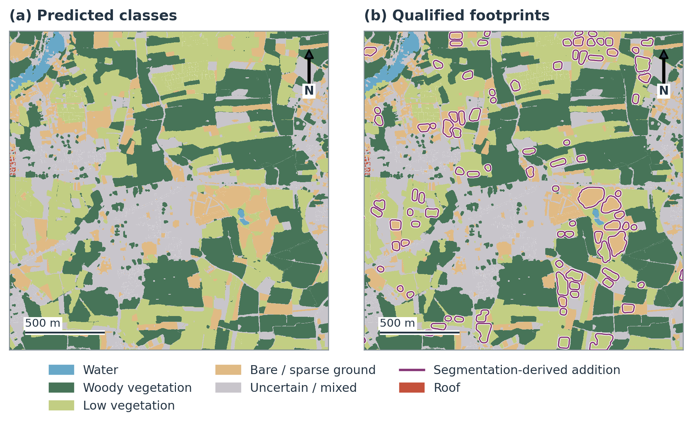
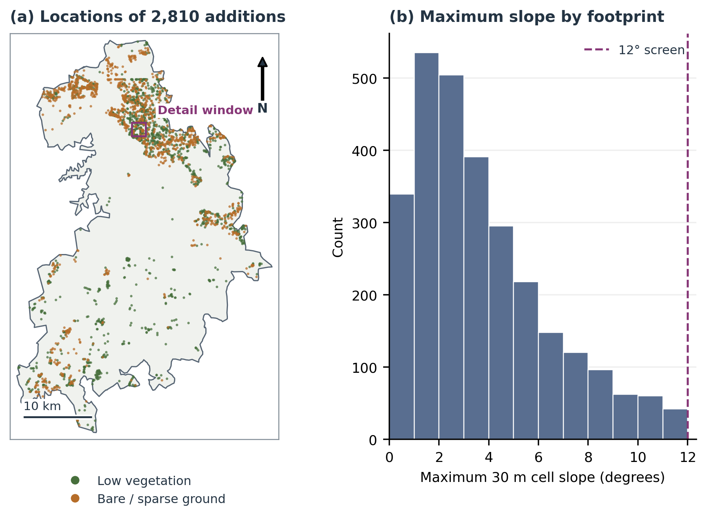

# HELPS

**Helicopter Emergency Landing Place Suggestion System** turns dated aerial imagery into a reviewed terrain dataset and uses that dataset to rank research landing opportunities for LCH, LUH and ALH aircraft. **Build knowledge** prepares and reviews a region. **Application** assesses candidates against aircraft, mission, location and weather evidence.

HELPS is a local research tool. Its candidates require independent verification before any operational use.

## Start on Windows

From an existing checkout with Python and the local data in place, run `.\launch.ps1` in PowerShell and open [HELPS on localhost](http://127.0.0.1:5000). Use `.\launch.ps1 -Port 5001` to change the port.

For a fresh checkout, install Git, Git LFS and Python 3.10, then run these commands in PowerShell.

```powershell
git lfs install
git clone --branch codex/unified-helps https://github.com/ManimeghanathA/HELPS.git
Set-Location HELPS
git lfs pull
py -3.10 -m venv .venv
.\.venv\Scripts\python.exe -m pip install -r requirements.txt
if (-not (Test-Path -LiteralPath .env)) { Copy-Item -LiteralPath .env.example -Destination .env }
.\.venv\Scripts\python.exe -m flask --app app run --host 127.0.0.1 --port 5000
```

To build from new imagery, configure the local SAM checkpoint, GeoSAM code, trained forest and worker environments. These assets are separate from the Flask dependencies. [Model and worker setup](docs/rgb-ingestion.md#model-and-worker-setup).

To open a previously accepted dataset on another computer, restore the matching local `data` tree and relink mutable paths using the Drive guide. Git contains the source and selected reference data. Generated knowledge, model weights, local credentials and bulk imagery are transferred separately. The guide records the original Bhadra backup and verification procedure. [Drive restoration](docs/restore-from-drive.md) · [Bhadra data manifest](docs/data-assets-2026-10-21.json).

## Build and approve terrain knowledge

1. Open **Build knowledge** and enter a region name and the image's capture date. Reuse the same region name for a later observation of that region.
2. Upload a polygon or multipolygon **GeoJSON** boundary and a georeferenced, dated **8-bit RGB GeoTIFF** that fully observes the boundary. An optional alpha band must be opaque within the boundary. Let HELPS derive the working resolution from the image or choose a resolution between **0.5 and 2 m**. The interactive build caps the area at **4 km²**, the plan at **32 tiles**, the image at **256 MiB** and the boundary at **2 MiB**. [Input contract](docs/rgb-ingestion.md#prepare-the-inputs).
3. Start the build and follow its status in the job list. The detached Windows worker tiles the image with overlap, uses SAM to propose regions and the GeoSAM random forest to classify them, and stitches class 3 and 4 seed geometry across tile boundaries. It reuses or acquires covering elevation, retains valid terrain at or below **15°**, applies the shared geometry and clearance rules, and builds a knowledge package for review.
4. Open the finished job's preview and inspect the map, candidate measurements and source limits. Confirm the proposal to select it for that region, or reject it. A pending or failed job leaves the previously selected dataset in use.

You can close the browser or stop Flask during processing and return to **Build knowledge** later. Keep Windows awake. Job status, resume behavior and review API calls are documented in the [RGB ingestion guide](docs/rgb-ingestion.md#track-and-review-a-build).

## Assess a landing opportunity

Select **Bhadra** in **Map** or **Application** after restoring the accepted package. **Candidates** lists terrain footprints and measured slope subregions. In **Application**, choose an aircraft and mission, enter coordinates or select a point on the map, set the search radius, then run the assessment. You can also select a region after accepting its RGB build.

Open a result to see its footprint, score, evidence and checks that need verification. Known hard failures exclude a candidate. Research results can include candidates with unknown checks, and the engine can return zero opportunities. The score compares mission priorities using supported evidence and has no probabilistic interpretation. Candidate counts can change with coverage, imagery date, classification and terrain filters.

## Bhadra case study

The accepted package for **Bhadra, Karnataka, India**, `bhadra-cv-20260601-313234b7`, contains **4,474 candidate polygons** and **25,931 measured slope subregions**. It combines **1,664 fragments** of previously retained candidates, refined with segmentation-derived exclusions, and **2,810 segmentation-derived additions** that passed geometry checks and a **12°** slope limit. The acquisition date of the high-resolution RGB imagery is unknown. The app opens this existing package from the local registry. New builds use the dated RGB upload workflow above. [Bhadra results and reproducibility](docs/results/bhadra-segmentation.md).





The regional map shows one point per added footprint.

The journal draft describes the workflow, the Bhadra case study and the evidence needed to evaluate detection and ranking. [IEEEtran manuscript](docs/paper/helps-ieee.tex) · [Two-column PDF](docs/paper/helps-ieee.pdf) · [Evidence and figure reproduction](docs/paper/README.md).

The RGB forest was developed for the Bhadra scene and may classify cover differently elsewhere. Bhadra uses a 30 m FABDEM terrain grid. New builds can use public Copernicus GLO-30 elevation, a surface model at roughly 30 m that can include vegetation and structures. Ground firmness, complete obstacle and restriction coverage, and safe approach paths require independent evidence. [Elevation sources](docs/automatic-elevation.md) · [Vision model audit](docs/reviews/2026-10-20/cv-integration-assessment.md).

## Repository and tests

| Location | Contents |
| --- | --- |
| `app.py`, `launch.ps1` | Local Flask entry points |
| `templates/`, `static/`, `scripts/ui/` | Browser interface and APIs |
| `scripts/knowledge/` | RGB processing, terrain measurement, package storage and review |
| `scripts/pipeline/`, `scripts/processing/` | Geospatial input, acquisition and geometry utilities |
| `scripts/recommendation/` | Aircraft checks, weather policy, ranking and explanations |
| `data/knowledge/` | Local registry, jobs and validated GeoPackages |
| `docs/reviews/`, `docs/archive/` | Dated reviews and historical material |

```powershell
.\.venv\Scripts\python.exe -m pytest tests -q
node --test tests/*.cjs tests/*.test.js
```

Node.js is needed for frontend tests. [RGB ingestion and API reference](docs/rgb-ingestion.md) · [Weather module](docs/reference/weather-module.md).
